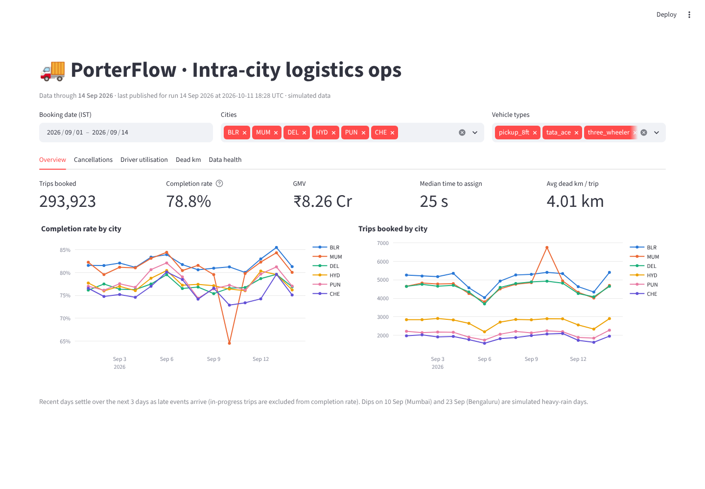
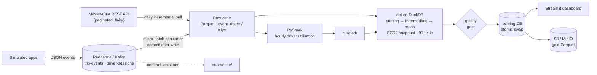
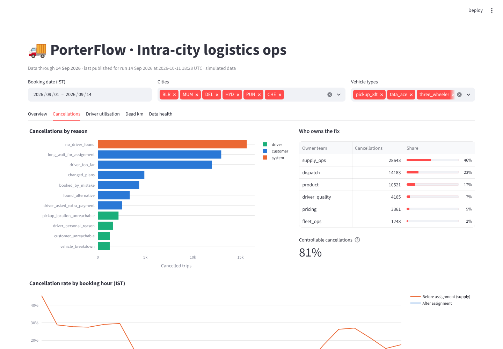
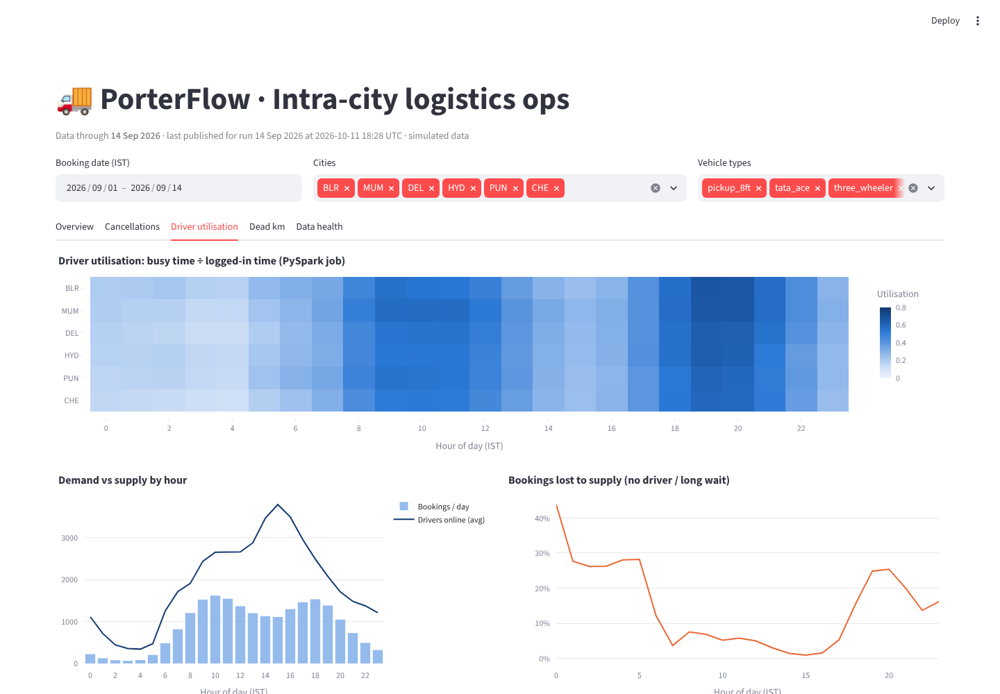
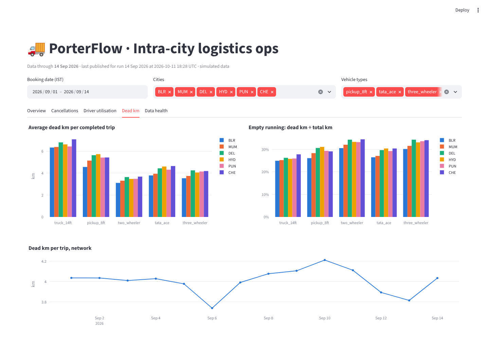
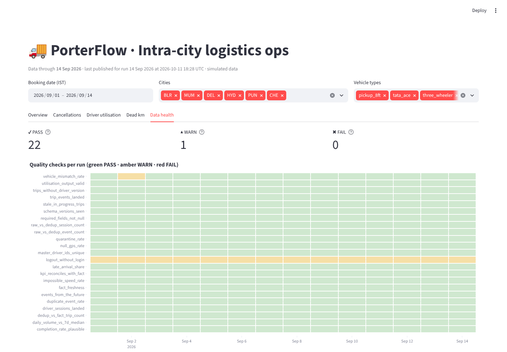

# PorterFlow

**An end-to-end data pipeline for a simulated intra-city logistics platform**: trip and driver events
stream through Kafka into a partitioned Parquet lake, Spark and dbt turn them into a tested star schema,
Airflow runs it daily with quality gates, and an ops dashboard shows completion rate, cancellations,
driver utilisation and dead km.

`Python` · `Kafka (Redpanda)` · `Parquet` · `Airflow 2.10` · `dbt + DuckDB` · `PySpark` · `MinIO (S3)` ·
`Streamlit` · `Docker Compose`

```bash
git clone <this repo> && cd porterflow
make up            # = cp .env.example .env && docker compose up -d --build
```
Then open Airflow at http://localhost:8080 (`airflow` / `airflow`) and the dashboard at http://localhost:8501.
The DAG starts on its own and backfills 14 simulated days.



---

## What it does

A Python simulator plays Porter's apps: customers book trips across six cities and five vehicle types,
a dispatch loop assigns the nearest free driver, and drivers pick up, deliver or cancel. It emits the
events with the mess real mobile data has:

| Injected defect | Rate | Where the pipeline handles it |
|---|---|---|
| Duplicate events (app resends) | 1.5% | dedup on `event_id` in `int_trip_events` |
| Late events (uploaded 1-72 h later) | 2% | load-time incremental models + Spark lookback window |
| Missing GPS fixes | 1% | flagged; excluded from dead-km instead of counted as 0 |
| Odometer/GPS glitches (impossible speed) | 0.3% of deliveries | `is_speed_anomaly`, kept out of distance KPIs |
| Device clock skew (out-of-order events) | 0.5% | `has_out_of_order_events` flag |
| Drivers switching vehicles | ~0.4% of drivers/day | SCD Type 2 `dim_driver` |
| App reporting the old vehicle after a switch | stale cache | `is_vehicle_mismatch` + rate check |
| Malformed messages (bad JSON, unknown city, bad timestamp) | 0.03% | quarantined by the consumer, never loaded |
| Missing driver logouts | 0.5% | sessions capped and flagged |
| Flaky master-data API (429/503) | 10% of calls | retries with exponential backoff + `Retry-After` |

Every injected defect is recorded as ground truth inside the simulator, so the tests can prove the
pipeline catches it.

## Architecture



The Airflow DAG `porterflow_daily` (one run = one IST business day):

```
simulate_source → consume_stream_to_raw ─┐
                  extract_master_data ───┴→ raw_quality_gate → spark_driver_utilisation
  → dbt_build → warehouse_quality_gate → publish_serving → export_to_cloud
```

Details and the reasoning behind each choice: [docs/architecture.md](docs/architecture.md).

## Layer by layer

| Layer | What is built | Code | Interview topic |
|---|---|---|---|
| Source | Deterministic simulator: fleet, shifts, dispatch, trips, defects | `src/porterflow/simulator/` | realistic test data, event schemas |
| Streaming ingestion | 2 topics (6 + 3 partitions, keyed by `trip_id` / `driver_id`), idempotent producer, consumer that validates, lands and **then** commits | `ingestion/producer.py`, `ingestion/consumer.py` | topics, partitions, offsets, at-least-once |
| Batch ingestion | Incremental REST extract per data interval, pagination, retries, idempotent partition overwrite | `ingestion/master_data.py`, `api/app.py` | API ingestion, backoff, incremental extracts |
| Raw zone | Typed Parquet, hive-partitioned by `event_date` (IST) and `city`, atomic writes, offset-based file names | `ingestion/raw_writer.py`, `schemas.py` | file formats, partitioning, data contracts |
| Orchestration | Daily DAG, catchup/backfill, retries with backoff, `max_active_runs=1`, `full_refresh` param | `dags/porterflow_daily.py` | DAGs, retries, backfills, idempotency |
| Transformation | dbt star schema: `fct_trips` (accumulating snapshot), `dim_driver` (SCD2), `dim_vehicle`, `dim_city`, `dim_date`, KPI marts | `dbt/porterflow/models/` | ELT, star schema, grain |
| History & late data | dbt snapshot (timestamp strategy), load-time incremental models with anti-join, delete+insert per trip | `snapshots/`, `models/intermediate/`, `fct_trips.sql` | SCD types, incremental loads, late data |
| Big-data job | PySpark: explode trips and shifts into IST hour buckets, broadcast join, dynamic partition overwrite of a 3-day window | `spark_jobs/driver_utilisation.py` | shuffles, joins, partition tuning |
| Data quality | Contract + quarantine, raw gate (12 checks), 91 dbt tests, warehouse gate (12 checks incl. row counts between layers) | `quality/checks.py`, `dbt/.../tests/` | data reliability |
| Serving | Blue/green publish of a serving DuckDB; dashboard with 5 tabs | `publish.py`, `dashboard/app.py` | data → business KPIs |
| Cloud | Gold tables to S3 (MinIO locally) with verified manifest; BigQuery/Athena guide | `publish.py`, `docs/cloud.md` | lake vs warehouse |

## Results (reference run: 14 days, 20,000 trips/day, seed 42)

| | |
|---|---|
| Kafka messages produced and landed | **1,219,467** (1,219,149 valid + 318 quarantined, 0 lost) |
| Raw trip-event rows → after dedup | 1,095,549 → 1,079,349 (16,200 duplicates removed) |
| Trips in `fct_trips` | 293,923 |
| Final trip status vs simulator ground truth | **99.97% match** (234,172 trips, days 1-11) |
| Automated data-quality checks | **115** (91 dbt tests + 24 gate checks); 322 check results, **0 failures**, 15 warnings |
| SCD2 driver versions created | 336 |
| Defects flagged in `fct_trips` | 707 impossible speeds, 307 out-of-order, 1,039 stale-vehicle trips |
| Runtime | ~45 s per simulated day on a laptop (≈1 min per day under Airflow) |

What the data says (simulated, but the analysis is the real deliverable):

* **Completion rate 78.8%.** 53% of cancellations happen *before* a driver is assigned
  (`no_driver_found`, `long_wait_for_assignment`): a supply problem, owned by supply ops.
* Supply-driven cancellations peak in the **evening (18:00-21:00) and late night**, while utilisation is
  highest at the same hours: not enough drivers are logged in when demand peaks.
* **Dead km is 4.0 km per completed trip, 31% of all km driven**: the target for better dispatch.
* The **Mumbai heavy-rain day (10 Sep)** shows up as ~40% more bookings than a normal weekday and
  completion falling from ~80% to 64.5%: demand rises while slower roads shrink effective supply.

Every number above comes from running the repo (`make up`, then the dashboard and `data/quality/`).

## Run it

**Requirements:** Docker with Compose v2 and about 6 GB of memory for Docker. All images are multi-arch,
so it targets Linux, macOS (Intel and Apple Silicon) and Windows (WSL2).

```bash
make up        # build images, start 9 services, unpause the DAG (it backfills on its own)
make status    # DAG run states
make logs      # follow the scheduler
make down      # stop (data in ./data is kept)
make reset     # delete all data, topics and Airflow metadata
```

| Service | URL |
|---|---|
| Airflow | http://localhost:8080 (`airflow` / `airflow`) |
| Dashboard | http://localhost:8501 |
| Redpanda Console (topics, partitions, consumer lag) | http://localhost:8085 |
| MinIO (S3) | http://localhost:9001 (`porterflow` / `porterflow-secret`) |
| Master-data API docs | http://localhost:8000/docs |

Settings live in `.env` (`PORTERFLOW_BACKFILL_DAYS`, `SIM_TRIPS_PER_DAY`, ...). For a bigger run:
`make reset`, set `SIM_TRIPS_PER_DAY=50000` and `PORTERFLOW_BACKFILL_DAYS=30` in `.env`, then `make up`.

Operations (backfill, re-run a day, full refresh, replay from Kafka, troubleshooting):
[docs/runbook.md](docs/runbook.md).

### Without Docker (development)

```bash
python3.11 -m venv .venv && source .venv/bin/activate
pip install "apache-airflow==2.10.5" -r requirements/pipeline.txt -r requirements/dev.txt \
    -c docker/airflow/constraints-2.10.5-3.11.txt
python -m venv .dbt-venv && .dbt-venv/bin/pip install -r requirements/dbt.lock.txt
export PYTHONPATH=src DBT_EXECUTABLE=.dbt-venv/bin/dbt

python -m pytest tests/unit -q                 # 49 unit tests, seconds, no services needed
python -m pytest tests/integration -q          # end-to-end incl. Spark (needs Java 17) and dbt, ~3 min

# full pipeline against a broker: docker compose up -d redpanda master-api minio
python -m porterflow.cli run --start 2026-09-01 --end 2026-09-03
python -m porterflow.cli task dbt_build --run-date 2026-09-03 --full-refresh
```

## Tests

| Suite | What it proves |
|---|---|
| `tests/unit` (49) | contract validation, simulator determinism and defect ground truth, offset-based idempotent file names, commit-after-write and crash re-delivery, API pagination/auth/windows, extract retries and idempotency |
| `tests/integration` (5) | full pipeline over 4 days: late events settle, final statuses match the simulator's truth (>99.5%), SCD2 history is used by the fact, re-running a day changes nothing, all gates pass |
| dbt (91) | keys, relationships, accepted values, SCD2 no-overlap, raw → intermediate → fact → KPI reconciliation, lifecycle order |

CI (`.github/workflows/ci.yml`) imports the DAG, parses dbt and runs both pytest suites on every push.

## Repository layout

```
porterflow/
├── docker-compose.yml          # 9 services: Redpanda + Console, MinIO, master-api, Postgres, Airflow, dashboard
├── Makefile                    # make up / status / backfill / rerun / full-refresh / reset / test
├── dags/porterflow_daily.py    # the DAG (thin: calls porterflow.tasks)
├── src/porterflow/
│   ├── simulator/              # world (fleet, SCD changes), trips (dispatch loop), mess (defects)
│   ├── ingestion/              # producer, consumer, raw_writer, master_data, kafka_admin
│   ├── api/app.py              # mock master-data REST API (FastAPI)
│   ├── spark_jobs/             # driver_utilisation.py (PySpark)
│   ├── quality/checks.py       # raw and warehouse quality gates
│   ├── schemas.py              # data contracts (pyarrow schemas + validators)
│   ├── publish.py              # serving DB swap + S3 export
│   ├── tasks.py · cli.py       # framework-agnostic tasks + command line
├── dbt/porterflow/             # models (staging/intermediate/marts), snapshots, seeds, tests, macros
├── dashboard/app.py            # Streamlit ops dashboard
├── tests/                      # unit + integration
├── docker/                     # Dockerfiles, Airflow constraints
└── docs/                       # architecture, interview guide, runbook, cloud
```

## Design decisions in one line each

* **ELT, not ETL**: raw lands untouched; all logic is SQL in git, tested, and re-runnable from raw.
* **Load-time incremental + recompute-by-key** is how late data stays correct without full rebuilds.
* **At-least-once + idempotent sinks** instead of Kafka transactions: the app's own resends need dedup anyway.
* **Accumulating-snapshot fact** because a trip is a process with milestones, not a single event.
* **Quality gates block publishing**, so the dashboard always shows the last good day, never a half-broken one.
* **Simulated, deterministic source** so every backfill, test and number is reproducible from a seed.

More: [docs/architecture.md](docs/architecture.md) · interview prep: [docs/interview_guide.md](docs/interview_guide.md).

## Screenshots

| Cancellations | Driver utilisation (Spark output) |
|---|---|
|  |  |
| **Dead km** | **Data health** |
|  |  |

---

All data is simulated; city names and vehicle classes are used for realism only. Not affiliated with Porter.
