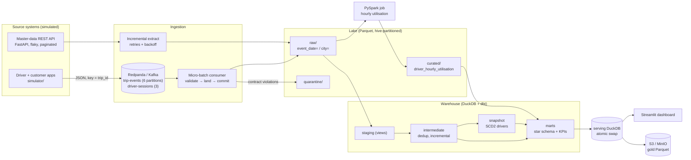
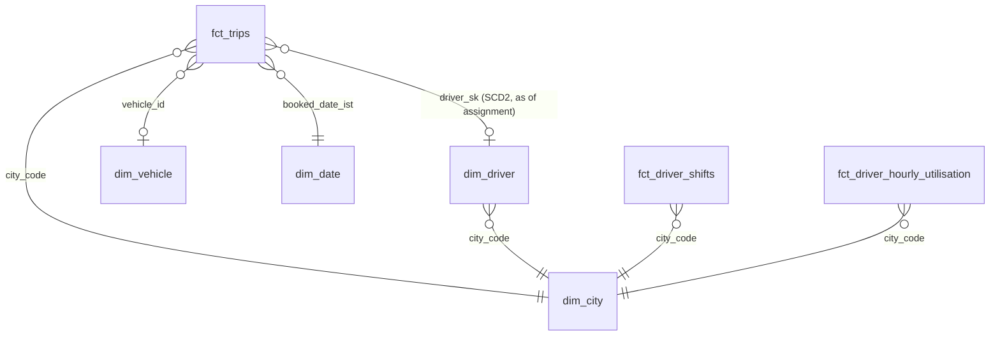

# Architecture and design decisions

This document explains *why* PorterFlow is built the way it is. Every section maps to a
question a data-engineering interviewer is likely to ask.

## 1. Data flow



Airflow runs the whole chain once per business day:

```
simulate_source → consume_stream_to_raw ─┐
                  extract_master_data ───┴→ raw_quality_gate → spark_driver_utilisation
  → dbt_build (seeds, models, snapshot, 91 tests) → warehouse_quality_gate → publish_serving → export_to_cloud
```

## 2. Why each technology

| Choice | Why | Alternative and when I would pick it |
|---|---|---|
| **Kafka (Redpanda)** for trip events | Apps emit events continuously; a log decouples producers from consumers, buffers outages (7-day retention) and lets any consumer replay from an offset. Redpanda speaks the Kafka protocol with one container and no ZooKeeper/JVM. | Kinesis / Pub/Sub on a managed cloud; plain batch files if latency never mattered. |
| **REST batch pull** for master data | Drivers and vehicles change slowly and live in an OLTP service; a daily incremental extract is cheap and simple. | CDC (Debezium) from the driver DB once changes must reach the warehouse within minutes. |
| **Parquet, hive-partitioned** | Columnar (read only the columns you need), compressed (zstd), typed, and splittable. `event_date`/`city` partitions let DuckDB and Spark skip whole folders (partition pruning). | Delta Lake / Iceberg to add ACID MERGE, time travel and schema enforcement on the lake. |
| **DuckDB + dbt (ELT)** | Load raw first, transform with SQL inside the warehouse: transformations are versioned, tested and re-runnable from raw at any time. DuckDB reads the Parquet lake in place, no load step. | BigQuery/Snowflake/Redshift with the same dbt project (only the adapter changes). |
| **PySpark** for utilisation | Exploding every trip and shift into hour buckets is the kind of wide, shuffle-heavy job that outgrows one machine first; Spark scales it horizontally. | Run the same logic in SQL (DuckDB/BigQuery) while data is small; Spark on EMR/Dataproc/Databricks when it is not. |
| **Airflow** | Dependencies, retries, schedules, backfills and a UI with per-task logs. Tasks are thin wrappers around plain Python functions (`porterflow/tasks.py`), so logic is testable without Airflow. | Dagster (asset-centric), Prefect; Airflow is what most Indian product companies run. |
| **Streamlit** | Python-native, fast to build, reads DuckDB directly. | Metabase/Superset for self-serve BI by non-engineers. |

## 3. Delivery semantics and idempotency

* **Producer**: `acks=all` + `enable.idempotence=true`, so a broker-side retry cannot write a message twice.
  The *app itself* still re-sends events (simulated at 1.5%), exactly like real mobile SDKs.
* **Consumer**: auto-commit is off. Messages are validated, written to Parquet (temp file + atomic rename,
  file name = partition + offset range), and only then are offsets committed synchronously.
  A crash between write and commit re-delivers the batch; because the file name is derived from the offsets,
  the re-landed file overwrites the old one. This is **at-least-once landing**.
* **Warehouse**: `int_trip_events` keeps the first copy of every `event_id`; `fct_trips` is rebuilt per
  `trip_id` with delete+insert. Duplicates of any origin collapse here: **effectively-once results**.
* **Every task is idempotent for its run date**: master extract windows are derived from the date (not from
  "now") and overwrite their partition; Spark overwrites only the date partitions it recomputes; the serving
  database is rebuilt and swapped atomically. Re-running any day changes nothing
  (`tests/integration::test_rerunning_a_day_is_idempotent`).

Exactly-once *inside* Kafka (transactions + `read_committed`) would not remove the app's own resends,
so deduplication on a business key is needed regardless.

## 4. Late-arriving data

Phones upload events late (2% of events, 1-72 hours late). Three mechanisms handle them:

1. **Partition by event time, load by load time.** A late event lands in the *old* `event_date` partition,
   and every row carries `_loaded_at_utc`.
2. **dbt incremental models filter on load time, not event time**, with a 2-hour overlap
   (`late_lookback_hours`) made safe by an anti-join on `event_id`. Then `fct_trips` recomputes every trip
   touched by a newly loaded event from *all* of that trip's events. An *accumulating snapshot* fact: a trip
   moves from `in_progress` to `completed` when its delivery event finally arrives.
3. **Spark recomputes a sliding window** of the last 3 days on every run (`PORTERFLOW_LATE_LOOKBACK_DAYS`)
   with dynamic partition overwrite.

Trade-off: a bigger lookback window catches later data but costs more compute. Events later than 3 days
still reach `fct_trips` (load-time incremental) but not the hourly utilisation of that old day until a
backfill of that range.

## 5. History: SCD Type 2

Drivers switch vehicles (~0.4% of drivers a day). `snapshots/snap_drivers.sql` is a dbt snapshot with the
`timestamp` strategy on the source's `updated_at`, so `valid_from` is when the change happened in the source
system, not when the job ran: backfills produce the same history. `dim_driver` exposes
`valid_from_utc/valid_to_utc/is_current`, and `fct_trips` joins **as of the assignment time**, so a trip
always points to the vehicle the driver had on that day. Vehicles themselves are SCD Type 1 (overwrite).

Snapshot caveat (worth saying in an interview): a snapshot only sees the state at each run. Two changes
between runs collapse into one. Here the source's incremental API returns the latest state per window, so
the same limitation exists upstream; CDC would capture every intermediate version.

## 6. Data model



* **Grain of `fct_trips`: one row per booked trip.** Lifecycle timestamps are columns (accumulating
  snapshot), so funnel durations (time to assign, pickup wait, trip duration) are simple subtractions.
* **Star, not snowflake**: dimensions are denormalised (vehicle type attributes are copied into
  `dim_vehicle`), trading a little storage for one-join queries that BI tools and analysts get right.
* **Degenerate dimension**: `customer_id` lives on the fact; there is no customer master in scope.
* KPI marts (`agg_city_daily`, `agg_driver_daily`, `agg_cancellations`, `agg_city_hourly`) are rebuilt as
  tables each run: they are small, and full rebuilds are simpler and always correct.

## 7. Data quality: three layers

| Layer | Where | Examples | On failure |
|---|---|---|---|
| Contract (per message) | `schemas.py`, consumer | unparseable JSON, unknown city, missing trip_id, bad timestamp, out-of-range GPS | message → `quarantine/` with the error, pipeline continues |
| Raw gate (per run) | `quality/checks.py` | volume > 0, duplicate rate, null-GPS rate, late share, impossible speeds, quarantine rate, unique master ids | FAIL stops the DAG before transform |
| dbt tests (91) | `models/**/_*.yml`, `tests/` | unique/not_null keys, relationships, accepted values, SCD2 no-overlap, raw→intermediate→fact reconciliation, lifecycle order | error-severity test stops downstream models |
| Warehouse gate | `quality/checks.py` | layer row counts reconcile, freshness, volume vs 7-day median, KPI = fact totals, utilisation in [0,1], SCD2 match rate | FAIL stops publishing |

Defects are *flagged, not deleted*: a trip with a GPS/odometer glitch keeps its fare but its distance is
excluded from distance KPIs (`is_speed_anomaly`); out-of-order timestamps are flagged
(`has_out_of_order_events`). Every check result is stored in `ops.dq_check_results` and charted on the
dashboard's Data health tab.

## 8. Time zones

All timestamps are stored as UTC (`*_utc`, timezone-naive). Business dates are IST and are always derived
with an explicit `+ interval 330 minute` (SQL) or `+19800 s` (Spark), never from a machine's local zone.
Partitions use the IST date, because "yesterday's trips" means the IST day to the ops team.

## 9. What changes at Porter scale

| Here | At production scale |
|---|---|
| 1 Redpanda broker, replication factor 1 | 3+ brokers, RF 3, `min.insync.replicas=2`, schema registry (Avro/Protobuf) |
| Daily micro-batch consumer in Airflow | Always-on consumer group (Kafka Connect S3 sink / Flink) writing hourly; Airflow orchestrates downstream batch only |
| Parquet folders | Iceberg/Delta tables (ACID MERGE, compaction of small files, time travel) |
| DuckDB single file | BigQuery/Snowflake/Redshift; the dbt project ports by switching adapter |
| `local[2]` Spark | EMR/Dataproc/Databricks with autoscaling; tune shuffle partitions to ~128-256 MB each |
| LocalExecutor | Celery/Kubernetes executor, SLAs, alerting to Slack/PagerDuty on gate failures |
| Real-time needs | Live trip tracking, surge pricing and dispatch need streaming (seconds); daily KPIs do not. |
